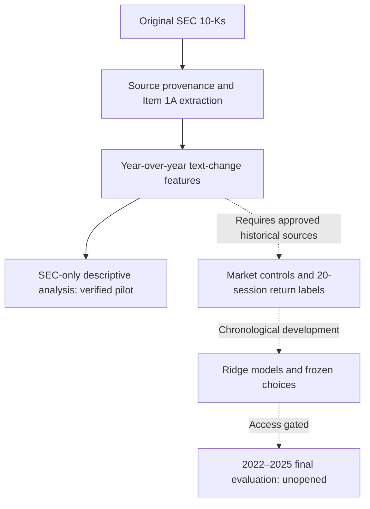

# Disclosure Drift

**Source-audited SEC Risk Factors analysis and point-in-time equity-return forecasting research.**

[](https://github.com/michaelbawuah/Disclosure-drift/actions/workflows/checks.yml)
[](pyproject.toml)
[](Makefile)

> **Research status:** The SEC-only descriptive analysis is complete and independently reproducible for its *purposively selected pilot sample*. The original **stock-return forecasting study is not yet empirically validated**. Historical security identity, source availability, and human review gates remain open; **the real 2022–2025 final evaluation has not been opened**.

## Research question

**Do year-over-year changes in the Risk Factors section (Item 1A) of annual 10-K filings improve forecasts of a stock's subsequent 20-trading-session market-adjusted return?**

The [locked research protocol](protocol.md) specifies a historically selected universe of large, liquid U.S. equities, an initial training period (2010–2015), chronological development (2016–2021), and a separately sealed final period (2022–2025).

The proposed comparison holds market controls constant and tests whether adding three text-change features—**Jaccard vocabulary distance, TF-IDF cosine distance, and log disclosure-length change**—improves an annual ridge-regression baseline. The outcome is a 20-session stock-minus-market total return, with the reference date set two XNYS sessions after the SEC filing's New York acceptance date.

That primary experiment is **not interchangeable** with the completed, SEC-only text analysis below.

## SEC-only findings

The separate exploratory study analyzes **215 original SEC 10-Ks from 35 issuers**, producing **180 consecutive annual Item 1A comparisons** between 2015 and 2021. Of those issuers, **34** have complete annual comparison records for 2019, 2020, and 2021.


For the **same 34 issuers**, the mean year-over-year Jaccard distance rises from **0.0968** in 2019 to **0.1428** in 2021. The within-issuer mean difference is **+0.0460** (median **+0.0438**), with **27 of 34** issuers showing an increase.

Here, *2019 versus 2021* compares the magnitude of each year's **change from its preceding 10-K**. It is **not** a direct text-distance calculation between the 2019 and 2021 documents.

| 2019 → 2021 exploratory contrast | Mean paired difference | Issuers increasing |
| --- | ---: | ---: |
| Jaccard vocabulary distance | **+0.0460** | **27/34** |
| TF-IDF cosine distance | **+0.00569** | **29/34** |
| Log annual Risk Factors length change | **+0.0435** | **24/34** |

A 5,000-draw issuer bootstrap gives a **0.0237–0.0724** interval for the Jaccard mean change, **conditional on the selected issuers**. It is not a population confidence interval. The log-length result's corresponding interval includes zero, while the original TF-IDF feature space expands across years and is **not a fixed-vocabulary comparison**.

**Interpretation:** These are descriptive measurements of lexical disclosure changes in a nonrandom document-format pilot. They are **not evidence of a causal event effect, broad-market representativeness, a trading strategy, or improved stock-return prediction**.

Read the [full SEC-only methods and results](docs/sec_only_descriptive_study.md), [alternative-metric sensitivity analysis](docs/sec_alternative_metric_sensitivity.md), and [independent numerical verification](reports/sec_only_descriptive_independent.json).

## What has been verified

| Research checkpoint | Evidence and remaining limits |
| --- | --- |
| **Original SEC sources** | 215 filing records and 180 annual text pairs in a 35-issuer pilot; 215 automated source audit passes. Complete human filing review is **not** claimed. |
| **Original Item 1A reinspection** | 30 distinct current original 10-K HTML documents checked: **28** directly bounded Risk Factors sections and **2** registered GE source-text ranges; **30/30** recorded token counts reproduced. Human sign-off remains pending. |
| **Independent source diagnostics** | 16 original 10-Ks from four explicitly post-hoc diagnostic issuers rechecked; **12/12** annual Jaccard and log-length comparisons and **4/4** issuer contrasts reproduced. |
| **Historical issuer/security candidates** | 135 provisional event calculations and **10,935** dated CRSP Names session checks reconciled. Original SEC issuer and stock-class corroboration improved, but **historical CIK–PERMNO links and source known-at remain unapproved**. |
| **IBM stock-class evidence** | Two original SEC Exhibit 4.1 documents corroborate IBM's registered *Capital stock* as its sole then-outstanding equity class. This does **not** approve a historical CRSP security mapping. |
| **Software integrity** | Latest published local reproduction: **1,257 passing pytest tests**, Ruff, and the complete synthetic end-to-end study pipeline. The CI badge shows current GitHub workflow status. |

The original SEC re-downloads and later archived source receipts sometimes have **different raw HTML hashes** even when the extracted facts or normalized risk text reproduce exactly. Those discrepancies are retained and **never silently treated as historically identical source versions**.

For the underlying evidence, see the [30-filing source review](docs/sec_boundary_30_review.md), [direct original-document audit](docs/sec_original_live_reinspection.md), [SEC stock-class review](docs/sec_cover_class_review.md), [IBM exhibit investigation](docs/ibm_capital_stock_exhibit_review.md), and [development identity matrix](docs/development_identity_matrix.md).

## Research workflow



The solid path represents the completed SEC-only descriptive workflow. The dashed path represents the **still-gated empirical forecasting study**, not results already obtained from historical stock returns.

Key safeguards in the [protocol](protocol.md) include point-in-time universe selection, source-bound CIK/security identity, training-only preprocessing, matured labels, chronological development, a fingerprinted freeze, and controlled access to final outcomes.

## Reproduce the software

**Requirements:** Python 3.12 and [uv](https://docs.astral.sh/uv/).

```bash
git clone https://github.com/michaelbawuah/Disclosure-drift.git
cd Disclosure-drift
make reproduce-full
```

That command runs Ruff, pytest, protocol checks and the **complete synthetic study** (including selection, annual model development, freeze, final-stage mechanics and robustness) on explicitly invented inputs. Its artificial final outcomes are **software test fixtures, not empirical results**.

The **SEC-only numerical study** can also be reproduced from the public original-feature checkpoints without WRDS or a new SEC download:

```bash
RUN_DIR="outputs/sec-descriptive-$(date -u +%Y%m%dT%H%M%SZ)"

uv run --locked --python 3.12 python scripts/run_sec_only_descriptives.py \
  --sources reports/pilot_expansion \
  --output "$RUN_DIR"

uv run --locked --python 3.12 python scripts/verify_sec_only_descriptives.py \
  --sources reports/pilot_expansion \
  --descriptives "$RUN_DIR" \
  --output "reports/independent-sec-descriptive-$(date -u +%Y%m%dT%H%M%SZ).json"
```

Detailed live-original, historical-market and identity audits require their **corresponding local source bundles**, which are not distributed with the repository. The scripts protect previously recorded source hashes and avoid fabricating approvals when a required file or reviewer decision is missing.

For other commands, run `uv run --locked disclosure --help` or see the [data request](docs/full_study_data_request.md) and [reproduction documentation](docs/research_completion_gates.md).

## What's left for the primary forecasting study

1. **Complete source-bound human review:** original Item 1A boundaries, stock classes, historical filing availability, and unresolved source conventions.
2. **Validate historical market identities:** effective-dated CIK–PERMNO/GVKEY relationships, a correctly selected investable universe, market-data `available_at`, and benchmark/return conventions.
3. **Run approved empirical development:** build the source-validated 2010–2021 population, choose models and secondary analyses using development data only, and freeze the decisions.
4. **Open the actual final evaluation only after the gates pass:** preserve the sealed 2022–2025 period until the approved freeze and audit trail permit access.

A completed synthetic pipeline, matching ticker, present-day SEC source, assistant-authored review, or manually changed approval flag **cannot** substitute for those requirements.

Track the [research completion gates](docs/research_completion_gates.md), [historical identity access evidence](docs/historical_identity_access_evidence.md), [benchmark source decision](docs/benchmark_source_decision.md), and [final-evaluation contract](docs/final_evaluation.md).

## Repository guide

| Location | Contents |
| --- | --- |
| [`src/disclosure_research/`](src/disclosure_research/) | SEC extraction, dated identity evidence, feature generation, model development, freeze and verification |
| [`scripts/`](scripts/) | Offline source audits, independent rechecks and focused reproduction CLIs |
| [`configs/`](configs/) / [`protocol.md`](protocol.md) | Locked methodology, source pins, registered resolution rules |
| [`tests/`](tests/) | Synthetic and adversarial regression checks |
| [`docs/`](docs/) | Research methods, source contracts, reviewer decisions and outstanding gates |
| [`reports/`](reports/) | Published aggregate checkpoints, figure, verification and progress reports |

The [execution log](reports/RESEARCH_EXECUTION_UPDATE.md), [experiment log](docs/experiment_log.md), and [decision log](docs/decision_log.md) retain the detailed chronology; the README is the overview.

## Research context

Inspired in part by Cohen, Malloy and Nguyen's [*Lazy Prices*](https://doi.org/10.1111/jofi.12885), this is a **separate** annual Risk Factors / 20-session return investigation. Their results are not evidence for this project's sample or outcome.

Research and implementation by **Michael Baffour Awuah**, with AI-assisted coding and draft reporting. Source checks, assistant reviews, independent software verification and required human approvals are tracked separately. Any future empirical conclusion must report its actual validated estimates—including negative or inconclusive results.
