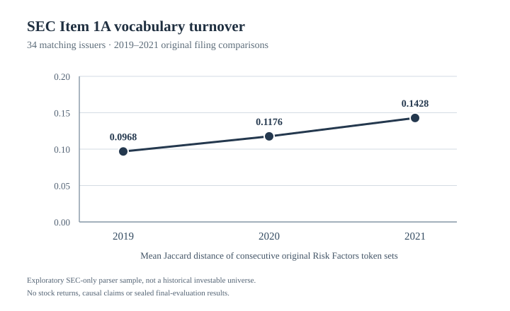

# SEC-only Risk Factors disclosure-drift descriptive study (exploratory)

**12 October 2026 — completed reproducible descriptive computation,
not the frozen stock-return forecasting study.**

Disclosure Drift originally tests whether *changes* in SEC annual Item 1A
Risk Factors improve future equity-return forecasts. The historical
CRSP/Compustat CIK-to-security `known_at`, data availability and full
historical selection are still awaiting defensible source and human review.
Rather than represent the forecasting study as finished, we created a
separate, deliberately narrower **SEC-only descriptive result** using
earlier source-audited original SEC text features. No WRDS account, new
licensed source, market return, security crosswalk, final-year holdout
or trading-performance computation was involved.

## Data and method

The [expanded SEC text source pilot](pilot_expansion.md) preserved
**215 original annual 10-K filings from 35 issuers** and **180 consecutive
year-over-year Item 1A Risk Factors text pairs**, accepted in 2015–2021.
All 215 source records passed prior automated source integrity checks.
The earlier pilot clearly records **zero complete human filing reviews**,
pending historical source dissemination, and a purposive document-format
sample instead of the predeclared investable market universe.

The **primary descriptive unit** here is the within-issuer change in the
Jaccard distance of consecutive annual risk-disclosure token sets:

\[
J_{i,t}=1-\frac{|W_{i,t}\cap W_{i,t-1}|}{|W_{i,t}\cup W_{i,t-1}|}.
\]

Larger Jaccard distance means greater vocabulary-set turnover between the
current original Item 1A and its prior-year original Item 1A. It does **not**
measure semantic novelty, prediction quality, the number of added words, or
investor surprise. Features are loaded from the *existing* audited
`reports/pilot_expansion/text_features.csv`, and their original filing
CIKs, acceptance years, links and immediate prior-year filing URLs are
rechecked against all 215 original `filing_sources.csv` records.

For year-to-year comparisons, retain exactly the **34 same issuer CIKs**
having consecutive annual comparison features in **all three years 2019,
2020 and 2021**. This gives a balanced panel of **102 individual annual
text-change observations**. One of the 35 issuers lacks a 2019 paired
comparison and is not included in this balanced comparison; its other
source records stay preserved in the full 180-pair summary.

For each issuer the exploratory principal contrast is
\[
\Delta_i=J_{i,2021}-J_{i,2019}.
\]
That compares the **2021 year-over-year change relative to 2020** against
the **2019 year-over-year change relative to 2018**, not a direct textual
comparison of 2021 against 2019.

This first SEC-only comparison is **exploratory, selected after examining
the available source sample**, not preregistered as the frozen predictive
study's primary hypothesis. Do not attach confirmatory p-values or a
causal narrative to it.

## Observed original-source descriptive results



*Mean within-filing year-over-year token-set change; 34 issuers present
in all three comparison years. No stock returns were used.*

| Balance-panel result | 2019 | 2020 | 2021 |
| --- | ---: | ---: | ---: |
| Original issuer CIKs | 34 | 34 | 34 |
| Mean year-over-year Jaccard distance | **0.0968** | **0.1176** | **0.1428** |

| Within-issuer change measure | 2019 → 2020 | 2020 → 2021 | 2019 → 2021 |
| --- | ---: | ---: | ---: |
| Mean Jaccard-distance change | +0.0208 | +0.0252 | **+0.0460** |
| Median change | −0.0003 | +0.0285 | **+0.0438** |
| Issuers with an increase | 17/34 | 24/34 | **27/34** |

The **2019→2021 within-issuer mean increase is 0.0460**, equivalent to
approximately **4.6 percentage points of the Jaccard-distance scale**,
not a 4.6% increase in stock returns. The median paired difference is
**+0.0438**. In the purposively selected balanced sample **27 of 34** issuers
had a larger *annual* token-set change measured in 2021 than in 2019.

Robustness/uncertainty diagnostics performed without reading other research
datasets:

- **5,000 issuer-level bootstrap draws**, using the frozen reproducibility
  seed, give a **0.0237 to 0.0724** conditional percentile interval for the
  2019→2021 *sample mean* change. This resamples only the 34 observed
  issuers; it is **not a population confidence interval**.
- Omitting any one issuer gives a mean paired change between **0.0377
  and 0.0492**. This particular observed comparison is therefore not
  wholly attributable to a single sampled issuer.
- The 2019→2020 paired median is nearly zero, and its conditional interval
  includes zero. Year-specific variation remains substantial.

No result establishes an effect of COVID-19, policy, market conditions,
or a particular global event. Nor does it establish that the observed
disclosure changes forecast asset returns.

## Original source integrity and independent recheck

The [computational source audit](../src/disclosure_research/sec_only_disclosure_descriptives.py)
verifies the original 180-row feature file against its stored SHA-256
checkpoint, the 215 original SEC filing manifest records and the frozen
protocol checksum. All 180 original issuer/acceptance-year/URL and
previous-year links match one-to-one, while 2015 TF-IDF is **missing by
design** and each later-year TF-IDF vocabulary uses only prior-year filing
pairs. The study's three paired comparisons use Jaccard, **not TF-IDF**,
since the TF-IDF vocabulary evolves over the calendar years.

A separately implemented
[independent verifier](../src/disclosure_research/sec_only_descriptives_verifier.py)
uses Python `Decimal` source rows and independent issuer-year mapping,
rather than the first implementation's Pandas joins, to recheck all 180
source features, the 34 balanced issuers, all individual paired differences,
the three mean/median and increase/decrease counts, the annual Jaccard
summaries, the deterministic issuer bootstrap and every leave-one-issuer-out
bound. It does not read market returns.

All 35 issuers are a deliberately selected SEC document-format pilot;
original source automated checks were complete, but human review is **still
pending**. Unknown source dissemination/first publication can affect claims
about contemporaneous investor observability. These descriptive statistics
are therefore **auditable exploratory source-feature measurements**, not a
representative estimate or an approved historical prediction result.

The publication-safe [aggregate checkpoint](../reports/sec_only_descriptive_checkpoint.json),
[independent verification](../reports/sec_only_descriptive_independent.json)
and [year-by-year SVG figure](../reports/sec_only_descriptive_balanced_means.svg)
contain no private issuer-level difference table. Individual source issuer
deltas and exact control receipts remain under ignored private `outputs/`.
The original risk text and individual filing metadata may be read from
the preexisting public sample evidence, not generated as new private returns.

## Reproduce the SEC-only result

From the repository root, use fresh private output names:

```bash
uv run --locked --python 3.12 python scripts/run_sec_only_descriptives.py \
  --sources reports/pilot_expansion \
  --output outputs/sec-only-descriptives-NEW
```

```bash
uv run --locked --python 3.12 python scripts/verify_sec_only_descriptives.py \
  --sources reports/pilot_expansion \
  --descriptives outputs/sec-only-descriptives-NEW \
  --output reports/independent-sec-descriptives-NEW.json
```

```bash
uv run --locked --python 3.12 python scripts/render_sec_only_descriptive_figure.py \
  --summary outputs/sec-only-descriptives-NEW/public_summary.json \
  --output reports/sec-descriptive-figure-NEW.svg
```

No SEC network calls, WRDS access, market-return calculations, final-period
records or historical CIK-to-PERMNO link approvals are required. The
[separate research completion gates](research_completion_gates.md) and
original frozen 2022–2025 holdout remain entirely unchanged.

## Appropriate use in a portfolio or resume

It is supportable to say that this project **implemented a reproducible,
source-audited original SEC Item 1A text analysis over 215 filings,
180 annual comparisons and 35 issuers**, and independently measured
a **+0.046 within-issuer mean increase in annual Jaccard token-set
distance between 2019 and 2021 comparisons in a 34-issuer balanced
exploratory panel**. State its purposive and descriptive scope when
discussing the result.

It is **not** supportable to claim a validated predictive uplift, a causal
event effect, a statistically representative U.S. stock result, a trading
strategy, historical `known_at`, complete human filing review or
completion of Milestones 5–11 in the original forecasting study.

## Reproducibility and independent verification checkpoint

The [public reproducibility receipt](../reports/sec_only_descriptive_reproduction.json)
records **1,222 passing repository tests**, Ruff and the complete
*invented-data software* study pipeline. A second run on the same saved,
hash-bound original SEC source CSV produced **byte-identical** issuer-level
Jaccard changes, public aggregate summary and published SVG chart.
A second independent `Decimal` source check reconstructed all 180 filing
pairs, all 34 balanced trajectories, year summaries, paired contrasts,
bootstrap intervals and leave-one-issuer-out sensitivity.

The two private execution receipts differ by timestamp and are not claimed
byte-identical. Reproducing a purposively selected SEC text sample does
**not** resolve original filing first-publication dates, full human
source review, investable-population representativeness, a causal
mechanism or any stock-return forecast.
